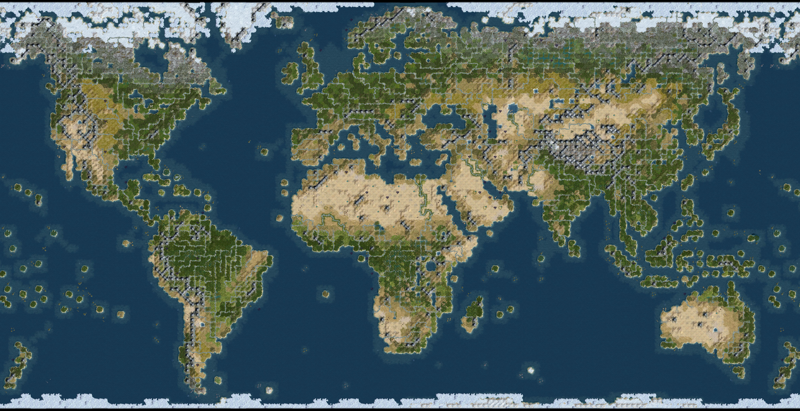

# Dawn of Civilization

The Dawn of Civilization mod for Civilization IV: Beyond the Sword, based on the popular Rhye's and Fall of Civilization mod.

## Overview

Rhye's and Fall of Civilization is one of the most popular mods for Civilization IV: Beyond the Sword. 
Rhye's and Fall intends to turn Civilization into a history simulator: the game is played on a realistic map of the world, civilizations start at historically accurate dates, the AI is encouraged to behave historically, and players can win the games by completing their historical victory.

Dawn of Civilization started out as a RFC modmod making several changes suited to my personal preferences. 
But it has since grown way beyond that.
With RFC not being in active development anymore, DoC has taken over to carry on its torch of providing historical BtS gameplay and now stands as its own full-fledged mod.

As the spiritual successor of Rhye's and Fall, Dawn of Civilization seeks to continue to improve upon its basic formula, and become an even better history simulator while also provide engaging and enjoyable gameplay.

For more information, you can also go to the [main thread on the development forums](http://forums.civfanatics.com/showthread.php?t=533861).

## Installation

If you just want to play, you only need to clone this repo into your mod folder (Beyond the Sword/Mods/) and rename it to "RFC Dawn of Civilization".

Alternate ways to get the mod:
* [Installer for DoC including Modules](https://sourceforge.net/projects/dawnofciv/files/Install%20Dawn%20of%20Civilization.exe/download)
* [Installer for DoC without Modules](https://sourceforge.net/projects/dawnofciv/files/Install%20Dawn%20of%20Civilization%20Core.exe/download)

## C++23 GameCore build

The GameCore port follows BridgedCvGameCore commit
`9d39528320203dbb8b36bef7b8f4ac74b06294c3`, applied to DoC baseline
`a3d4ad3f6c216019dbfb142431da3dcb1374ad58`. It uses pinned Clang/LLD 23.1.2
to produce a Windows x86 DLL, retaining the VC7.1 standard library ABI,
Python 2.4, Boost.Python 1.32 and DoC's existing gameplay and save fields.
The historical Visual Studio/Makefile build files remain as references.

Requirements: CMake 3.28+, Ninja, Python 3.9+ with `pefile==2024.8.26`,
7-Zip and the original BtS installation. Run commands from this repository's
root. Preserve the baseline DLL for the build's export comparison:

```bash
mkdir -p tmp/cxx23-port
git show a3d4ad3f6c216019dbfb142431da3dcb1374ad58:Assets/CvGameCoreDLL.dll > tmp/cxx23-port/original-CvGameCoreDLL.dll
```

### Linux

Use the pinned Linux LLVM 23.1.2 tools and ICU 70 libraries. Acquire the target
headers and exception runtime, or reuse the identical acquired dependencies
from a local BridgedCvGameCore checkout:

```bash
python3 tools/s2_deps.py --proton /path/to/Proton/proton --steam-client /path/to/Steam
python3 tools/s2_runtime_deps.py

BTS_DIR="/path/to/Beyond the Sword"
python3 tools/s3.py \
  --bts-dir "$BTS_DIR" \
  --llvm-bin /path/to/llvm-23.1.2/bin \
  --icu70-dir /path/to/icu70 \
  --vc71 "tmp/s2-deps/installed/Microsoft Visual C++ Toolkit 2003" \
  --windows-sdk tmp/s2-deps/installed/WindowsSDK \
  --exception-runtime tmp/s2-runtime-deps/minimum/vcruntime140.dll_x86 \
  --reference-dll tmp/cxx23-port/original-CvGameCoreDLL.dll
```

### Windows

Use the pinned Windows LLVM 23.1.2 archive identified in
`tools/s3-windows-lock.json`. Put Python, CMake and Ninja on `PATH`. In
PowerShell, extract the baseline without redirecting binary data through text:

```powershell
New-Item -ItemType Directory -Force tmp/cxx23-port | Out-Null
cmd /c "git show a3d4ad3f6c216019dbfb142431da3dcb1374ad58:Assets/CvGameCoreDLL.dll > tmp/cxx23-port/original-CvGameCoreDLL.dll"
python tools/s2_deps.py
python tools/s2_runtime_deps.py --seven-zip "C:/Program Files/7-Zip/7z.exe"
python tools/s3.py `
  --bts-dir "C:/Games/Beyond the Sword" `
  --llvm-bin "C:/LLVM-23.1.2/bin" `
  --vc71 "tmp/s2-deps/installed/Microsoft Visual C++ Toolkit 2003" `
  --windows-sdk tmp/s2-deps/installed/WindowsSDK `
  --exception-runtime tmp/s2-runtime-deps/minimum/vcruntime140.dll_x86 `
  --reference-dll tmp/cxx23-port/original-CvGameCoreDLL.dll
```

Both builds produce `tmp/s3-build/CvGameCoreDLL.dll` and a build report. Copy
that DLL into this mod's `Assets/` directory. The pinned `vcruntime140.dll`
from the build directory must be beside `Civ4BeyondSword.exe`; preserve any
existing file before replacing it. On Linux, use these Steam launch options:

```text
WINEDLLOVERRIDES="msvcr71,msvcp71,vcruntime140=n" %command%
```

DoC needs its existing `_MOD_FRACTRADE` definition and Psapi import library in
addition to the stock port. The compiler fixes retain the reference port's
token-paste, loop-scope, complete-type, string-conversion and varargs changes.
DoC's extra logging helpers also use compiler-aware varargs; its additional
wide sign formats use wide literals. Other DoC fixes give mutable-reference
calls named string temporaries, remove unused format arguments and pass the
hurry-overflow buffer's text pointer to the variadic text service. The header
adapter adds an `IUnknown` forward declaration and erases the missing
`__deref_opt_out_z` annotation required by the pinned shell headers. No bundled
Boost/Python source or downloaded Microsoft header is edited.

Validation on Linux/Proton: two clean 101-unit C++23 builds produce byte-identical DLLs; all 2,450 original
DoC exports and 1,207 executable-required exports are present. Paired original
and converted DLL tests register identical Python API surfaces, pass 1,000
wrapper lifetime iterations and wrong-arity exception handling, and finalize
Python and unload successfully. These checks cover compilation, symbols and
binding startup; DoC gameplay, UI, save round trips and multiplayer still need
their own in-game validation. The Windows host build has not been exercised
for this DoC port.

## Main Features

The main goals of DoC are:
* Representing parts of the world not represented by RFC
* Improving on historical accuracy without sacrificing gameplay
* Offering new content in the form of civilizations and victory types
* Improving and optimizing existing RFC features
* Adjusting base game elements to better suit a historical mod

Rhye's and Fall was created more with the intention of taking the normal BtS content into a framework that makes it a historical simulator. 
Dawn of Civilization looks beyond that and tries to make an even better history simulator by including content beyond what BtS offered. 
This is most evident in the inclusion of additional civilizations, but also in many rule and mechanic changes.

In my opinion, a good historical simulator always also has to be a good game. 
This is why perfect historical accuracy isn't the goal of DoC - playing this game is about making interesting decisions and seeing their impact on the world. 
So instead of forced or scripted historical events, DoC tries to include events and mechanics that encourage developments along historical lines without making them a certainty. 
DoC also isn't a kitchen sink mod - every feature included has to serve a clear purpose in improving historicity or gameplay experience.



The main features of Dawn of Civilization are:
* Inclusion of Beyond the Sword civilizations that have been left out: Korea, Byzantium, Holy Rome
* Many new, completely playable civilizations: Harappa, Assyria, Nubia, Hittites, Polynesia, Celts, Dravidia, Toltecs, Kushans, Tibet, Malaysia, Turks, Moors, Java, Burma, Rus, Vietnam, Swahilis, Poland, Italy, Mughals, Thailand, Sweden, Congo, Iran, Argentina, Mexico, Brazil, Colombia, and Canada
* Completely new, enlarged world map of 80 x 125 = 10000 tiles
* Completely new tech tree covering 141 technologies over 7 eras
* Added 36 new and changed 22 existing buildings
* Added 104 new and changed 24 existing wonders
* Added 26 new and redesigned several existing units
* Completely new selection of 42 civics from 6 categories
* Extended the game length by 100 turns
* You can play from 1700 AD in a new scenario
* Improved the interface in various ways by including the BUG mod
* You can play on Epic or Marathon game speed thanks to embryodead's RFC Epic/Marathon modmod
* Two new difficulty levels featuring stronger AI opponents
* Almost every already existing RFC civilization will experience an entirely different game due to changes in their unique power, unit or building, new historical victory goals or general starting situation and environment
* New stability system with more transparent factors, gradual effects of instability, and improved performance
* Diplomatic institutions overhaul: new rules and resolutions for the Apostolic Palace and United Nations, extended and optimized Congress mechanics
* New religions: Zoroastrianism, Orthodoxy, Catholicism and Protestantism. Christianity is founded as the Orthodox faith, with Catholicism and Protestantism branching off through specific events (the Great Schism and the Reformation, respectively)
* New religious spread rules, with religions gradually spreading around their holy city depending on historical spread in various regions on the map. Owner state religion can influence which religions can appear, and religions can disappear when the owner state religion changes
* Improved colonization of Africa and Asia: building the Trading Company grants conquerors to certain civilizations, and Congresses can be used to settle empty territory
* You can win through a new victory type, the Unique Religious Victory. Different victory conditions exist depending on your state religion. Without a state religion, you can still win the Polytheism (Pantheon civic) and Secularism (Secularism civic) victories
* Cultural control spreads gradually to individual tiles
* Inclusion of the SuperSpies mod: Spies acquire experience and promotions, Great Spies are created from Spy experience in the same way Great Generals are
* Dynamic soundtrack based on your location and state religion
* New specialist and great person type: Statesman and Great Statesman
* Female Great People with appropriate graphics
* Many new leaderheads have been added for all civilizations to cover all eras
* Additional requirements for wonders, such as civics, resources and religions, to enocurage their historical placement
* The plague can't kill units anymore
* The AI receives help in many ways so it can better create historical empires, especially for Greece, Persia, Rome, Arabia and Mongolia
* Many small changes to improve balance and AI performance
